# Bit by Bit 🛍️

**Own it bit by bit.**

**Bit by Bit helps small South African shops run lay-bys digitally, so customers can pay off goods in instalments with no interest and no debt, and shop owners always know who has paid what.**

| | |
|---|---|
| 🌐 Live app | [bit-by-bit-xpql.vercel.app](https://bit-by-bit-xpql.vercel.app) |
| ⚙️ API | [bit-by-bit-api.onrender.com/api/health](https://bit-by-bit-api.onrender.com/api/health) (free plan: the first request can take up to a minute while it wakes up) |
| 🎨 Stitch designs | [View designs](https://stitch.google.com/projects/10601282457004177971) |
| 🎥 Loom demo (5 min) | _Loom link goes here_ |

### Test logins
| Role | Email | Password |
|---|---|---|
| Shop owner (Kasi Kids Wear) | owner@bit-by-bit.test | BitByBit2026! |
| Customer (Thandi Mokoena) | customer@bit-by-bit.test | BitByBit2026! |

They come with 3 demo lay-bys: one on track (with a slip waiting for review), one overdue and high risk, and one paid up and ready to collect.

---

## 📄 Docs
- [BUSINESS.md](./BUSINESS.md): problem, customer, impact, business model, go-to-market, competition
- [Product Requirements (PRD)](./docs/PRD.md)
- [Implementation Plan](./IMPLEMENTATION_PLAN.md)
- [Designs](./docs/designs/) (exported from [Stitch](https://stitch.google.com/projects/10601282457004177971))
- [DEPLOY.md](./DEPLOY.md): how I deployed it to Render, Vercel and Supabase
- [Loom script](./docs/LOOM_SCRIPT.md)

## ✨ Features (Must), all live
1. **Log in with roles:** customers and shop owners each get their own pages, and the API checks the role on every request
2. **Create a lay-by:** the owner enters the customer's email, item, price, deposit (at least 10%) and term (1 to 6 months), and sees the schedule before saving
3. **Customer view:** every lay-by with what's paid, the balance, the next due date, a progress bar, the schedule and the payment history
4. **Payments:** the customer uploads proof (photo or PDF, max 5 MB) to a private bucket. The owner records cash (confirmed straight away) and confirms or rejects slips with a reason. Only confirmed payments count, nobody can overpay, and a lay-by becomes *paid up* by itself
5. **Owner dashboard:** active, overdue, ready to collect, payments to review and total outstanding, all from the real database. Plus mark as collected, cancel with a reason, and filter / search the lay-by list

## 🌟 Signature features
- ✅ **Lay-by risk score:** Low / Medium / High badges so shops can act before a customer gives up. It's credit-risk logic in a pure, fully unit-tested function ([riskScore.ts](./server/src/services/riskScore.ts)), and customers never see their own score
- ✅ **One-tap WhatsApp reminders:** a `wa.me` link with a ready-made message: name, item, amount due, due date and balance
- 🔜 PDF receipts and QR lay-by slips, progress milestones, PWA and isiZulu / Sesotho (designed in Stitch, next on the plan)

## 🖼️ Screenshots
Taken from the **live site** with the test logins (`cd e2e && npm run screenshots`).

| | Mobile | Desktop |
|---|---|---|
| Landing | 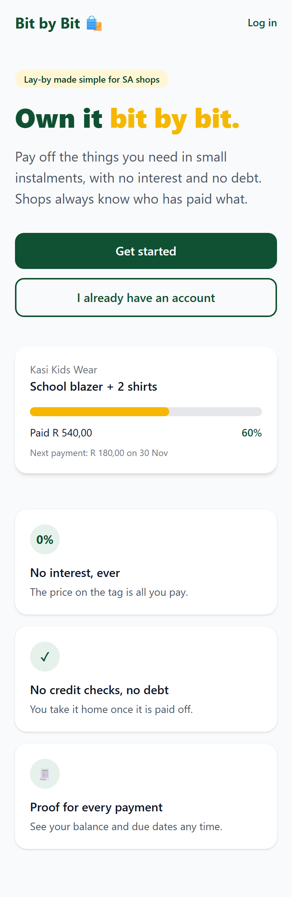 | 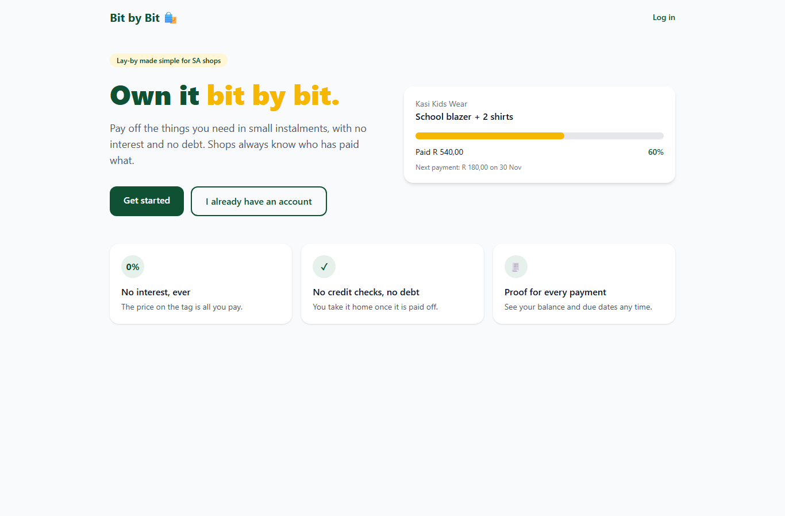 |
| Owner dashboard | 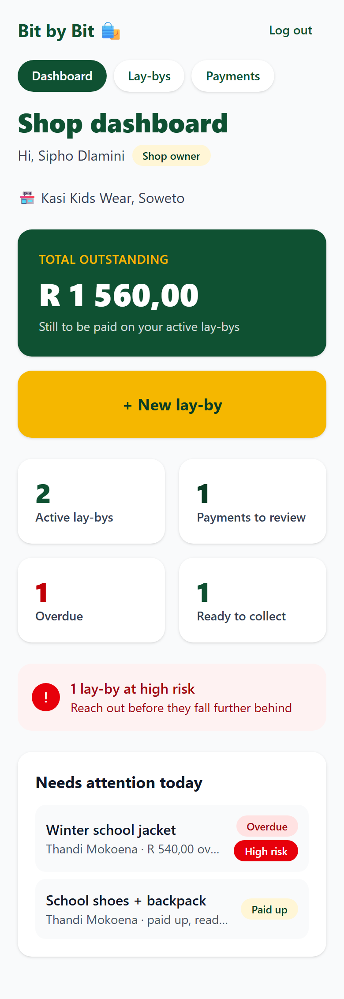 | 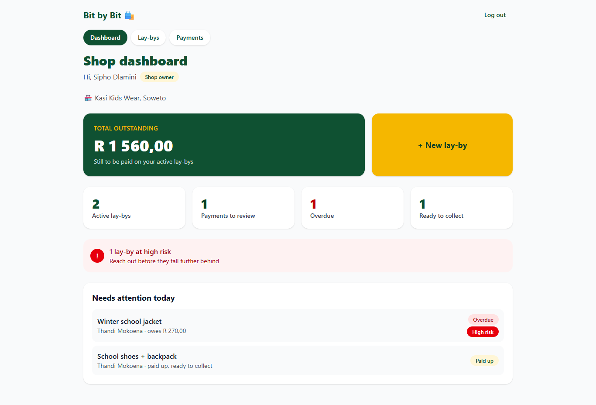 |
| Create lay-by | 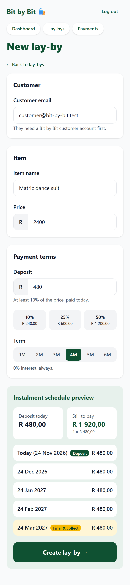 | 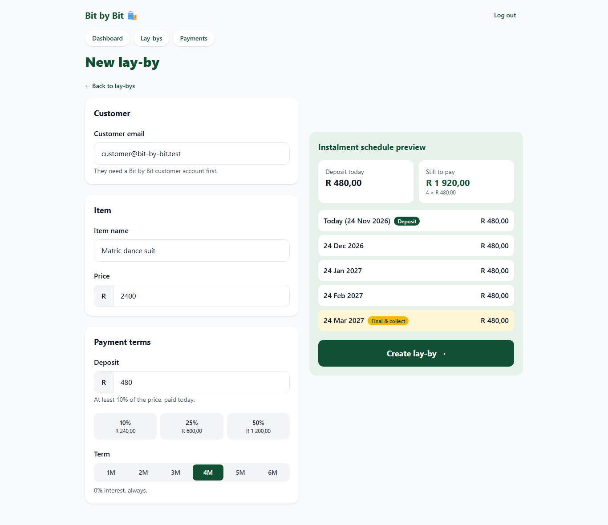 |
| Payments to review | 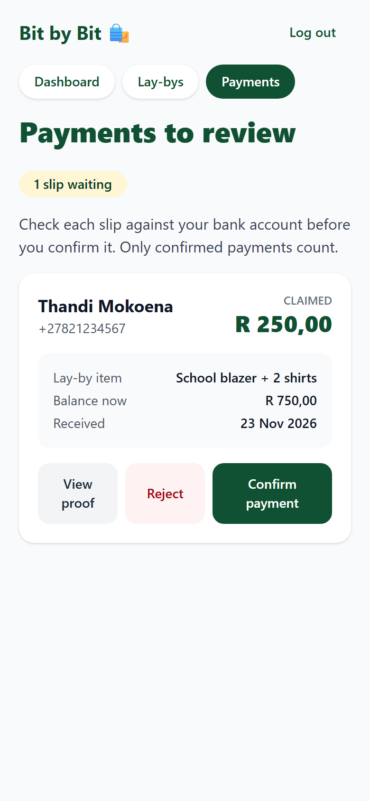 | 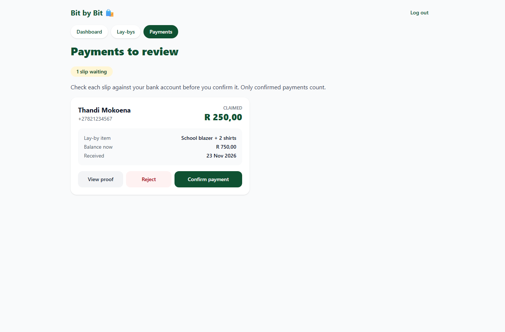 |
| Customer lay-bys | 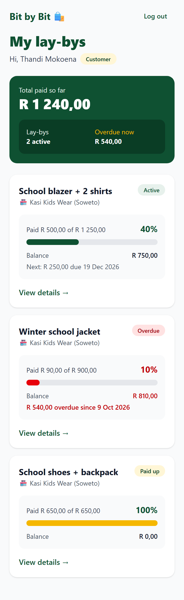 | 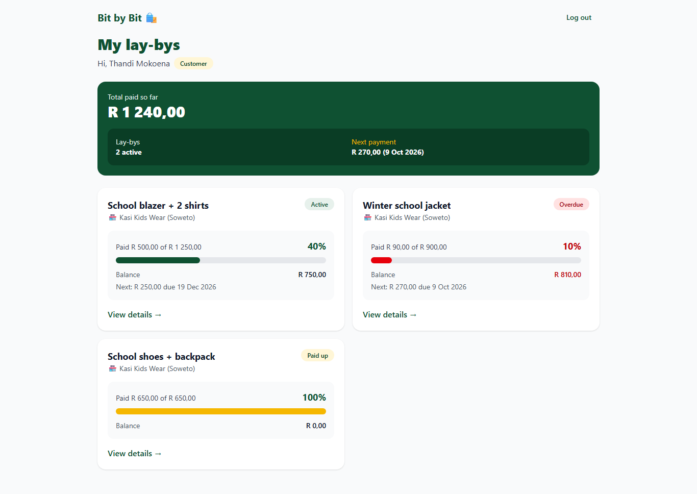 |
| Lay-by detail | 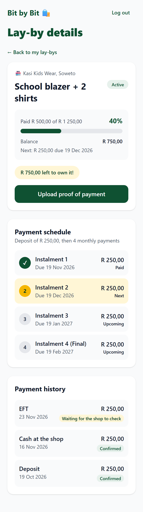 | 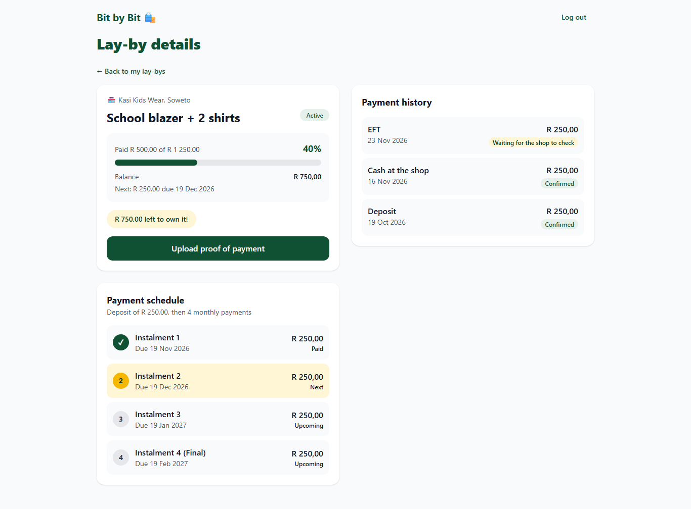 |

## 🛠️ Tech stack
- **Frontend:** React, TypeScript, Vite, Tailwind CSS
- **Backend:** Node.js, Express, TypeScript
- **Database and auth:** Supabase (Postgres, Auth, Storage, Row Level Security)
- **Testing:** Vitest, React Testing Library, Supertest, Playwright (end-to-end)
- **CI:** GitHub Actions (lint, typecheck, test and build on every PR)
- **Hosting:** Vercel (frontend), Render (backend), Supabase (database)

## 🏗️ Architecture
```
React (Vercel)  ──HTTPS──>  Express API (Render)  ──>  Supabase Postgres (RLS)
      │                            │
      └── Supabase Auth (JWT) ─────┘ verifies the token and role on every request
      │                            └──> Supabase Storage (signed links to proof files)
      └── uploads proof files straight to the private "proofs" bucket (RLS checks the folder)
```
Permissions are enforced twice on the backend: Express middleware checks the role, and Postgres Row Level Security makes sure customers only see their own lay-bys and shop owners only see their own shop's lay-bys.

**How a payment flows**
1. The customer's browser uploads the slip straight to the private `proofs` bucket at `<layby_id>/<file>`. A storage policy only lets them write into their own lay-by's folder.
2. The browser calls `POST /api/laybys/:id/payments` with the amount and the file path. The API checks the lay-by is theirs, the file really is in that folder, and the amount isn't more than what's owed. Then it saves a **pending** EFT payment.
3. The owner sees it under **Payments to review**. **View proof** asks the API for a link that works for 5 minutes. **Confirm** counts it towards the balance and marks the lay-by **paid up** when it reaches the price. **Reject** needs a reason, which the customer sees.

**Where the logic lives:** all the money rules are plain functions with no database calls, so they're easy to test: [laybyMath.ts](./server/src/services/laybyMath.ts) (schedule, balance, overdue), [paymentRules.ts](./server/src/services/paymentRules.ts) (no overpaying), [dashboard.ts](./server/src/services/dashboard.ts) (totals, collect / cancel rules) and [riskScore.ts](./server/src/services/riskScore.ts). The React app imports the same files for its live previews, so the browser and the server can never disagree. Every amount is worked out in cents, so R0,10 + R0,20 really is R0,30.

**API**
| Method | Endpoint | Who |
|---|---|---|
| GET | `/api/me` | anyone logged in |
| GET / POST | `/api/laybys` | customer (own) / owner (shop); creating is owner only |
| GET / PATCH | `/api/laybys/:id` | customer (own) or owner (shop); collect / cancel is owner only |
| POST | `/api/laybys/:id/payments` | customer (EFT + proof) or owner (cash) |
| GET | `/api/payments` | owner: slips waiting for review |
| GET | `/api/payments/:id/proof` | the lay-by's customer or owner: a 5-minute signed link |
| PATCH | `/api/payments/:id` | owner: confirm or reject |
| GET | `/api/dashboard` | owner: totals, high-risk count, needs attention |

## 💻 Run it locally
```bash
git clone https://github.com/SIJABULILE-NCUBE/bit-by-bit.git
cd bit-by-bit

# backend
cd server
cp .env.example .env   # add your Supabase URL and keys
npm install
npm run seed   # optional: test logins + 3 demo lay-bys (safe to run again)
npm run dev

# frontend (new terminal)
cd client
cp .env.example .env
npm install
npm run dev
```

## 🧪 Run the tests
```bash
cd server && npm test   # API, permissions, lay-by maths, payments, dashboard, risk score
cd client && npm test   # pages, forms, money formatting, WhatsApp message

# end-to-end: a real browser, the owner creates a lay-by and the customer sees it
cd e2e
npm install
npx playwright install chromium
npx playwright test                                                    # starts the API and app locally
E2E_BASE_URL=https://bit-by-bit-xpql.vercel.app npx playwright test    # or test the live site
```
CI (GitHub Actions) runs lint, typecheck, unit tests and the build for the client and the server on every PR. The end-to-end test makes (and then deletes) real data, so for now I run it by hand rather than in CI (see the known issues).

## ⚠️ Known issues
- **The first load can be slow:** the API is on Render's free plan, so it sleeps after about 15 minutes with no visits. The first request after that can take up to a minute while it wakes up. After that it's quick.
- **One Supabase project:** local development, the end-to-end test and the live site share one database, which is why the E2E test isn't in CI yet. Next step: a separate Supabase test project, so the E2E test can run in CI too.
- **Payments are proof-based:** customers pay by EFT or cash and upload a slip. There are no in-app card payments yet (PayFast / Ozow are on the Could list).
- **If saving fails after a slip upload,** the file stays in storage with no payment linked to it. The customer can just try again; it only uses a little storage.
- **The customer needs an account first:** the owner can only create a lay-by for an email that has already signed up as a customer.
- **Not built yet:** PDF receipts, QR slips, milestones, PWA and the language switch (see the signature features).

---
Built by **Sijabulile Ncube** · [GitHub](https://github.com/Sijabulile-Ncube) · [LinkedIn](https://linkedin.com/in/sijabulilemn)
